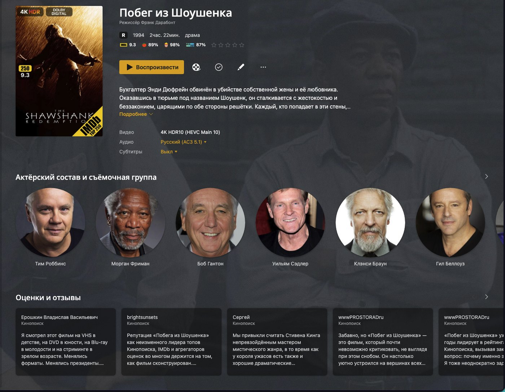
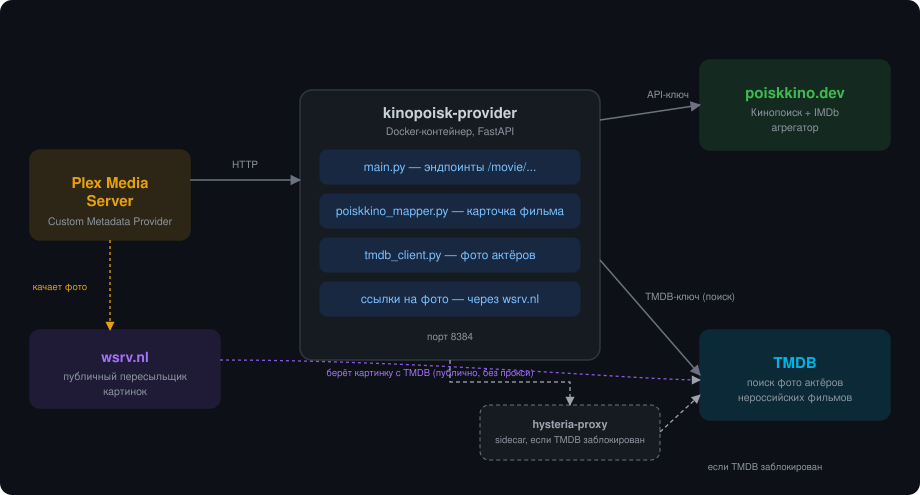

# 🎬 Kinopoisk Custom Metadata Provider for Plex

**Russian-language movie metadata for Plex Media Server, sourced from Kinopoisk** — synopses, ratings, cast, reviews in Russian, trivia and franchise collections. A replacement for `Kinopoisk.bundle`, which Plex stopped loading in 1.43.0.

By **Sergey Sychev** · [Русская версия](README.md) · MIT licensed



*What a movie page looks like: synopsis and reviews in Russian, Kinopoisk and IMDb ratings, budget and box office, trivia, cast photos.*

---

## Why this exists

Plex used to support third-party metadata agents (legacy plugins), and Kinopoisk had one: `Kinopoisk.bundle`. As of PMS **1.43.0** the legacy plugin engine is gone — those agents simply don't load any more. In its place Plex introduced **Custom Metadata Providers**: a plain HTTP service that Plex calls when it matches a movie or refreshes its metadata.

This project is that service for Kinopoisk, packaged as a Docker container.

**Who it's for:** anyone whose Plex library is watched in Russian. Plex's own agent returns English synopses and English-language reviews; this provider returns the Russian ones, written for a Russian audience, plus the trivia and box-office figures Kinopoisk collects.

## What you get on a movie page

- Title, year, tagline and synopsis **in Russian**
- Kinopoisk and IMDb ratings (as text in the synopsis — see [FAQ](#why-are-ratings-text-instead-of-a-badge))
- Full cast and crew
- **Cast photos from TMDB** for non-Russian productions — a free TMDB key is all it takes (since v0.18.2)
- **Reviews in Russian** from Kinopoisk
- **Trivia and goofs** from Kinopoisk, plus budget and box office
- **Franchise collections** — all parts of a series grouped automatically
- Similar movies
- Release date taken from the **worldwide** premiere, not the Russian re-release
- IMDb and TMDb ids on the item, so tools like Kometa can sort your library correctly

## How it works



All core data comes from Kinopoisk via **[poiskkino.dev](https://poiskkino.dev)** (a Kinopoisk + TMDb + IMDb aggregator). Cast photos for non-Russian productions are looked up on TMDB; if TMDB is blocked on your network (common in Russia), the project ships an optional proxy sidecar for that lookup.

The image files themselves are **not** served by the provider. Plex fetches them through the public image mirror [wsrv.nl](https://wsrv.nl), which pulls the file from `image.tmdb.org` and serves it from a public address. This is necessary because **Plex refuses to download images from private network addresses** — it aborts the request before it is even sent. The upside: you need neither a proxy for images nor a publicly reachable address at home.

---

## Quick start (any platform with Docker)

You need **Docker** and **Docker Compose** — Synology, Unraid, QNAP, a plain Linux box or Docker Desktop all work the same.

### 1. Get an API key

Register with the Telegram bot **[@poiskkinodev_bot](https://t.me/poiskkinodev_bot)** for a free poiskkino.dev API key. The free tier allows 200 requests/day, which is enough for a home library.

### 2. Get the project

```bash
git clone https://github.com/Serka76/Kinopoisk-Provider.git
cd Kinopoisk-Provider
```

### 3. Configure

```bash
cp docker-compose.yml.example docker-compose.yml
cp .env.example .env
```

Put your keys in `.env` — it is listed in `.gitignore`, so it stays out of the repo:

```ini
POISKKINO_API_KEY=your_key_from_the_bot
TMDB_API_KEY=your_tmdb_key
```

The [TMDB key](https://www.themoviedb.org/settings/api) is free and optional, but it gives you proper cast photos and keeps pages populated when the Kinopoisk daily quota runs out.

### 4. Run

```bash
docker compose up -d --build
curl http://localhost:8384/healthz
# {"status":"ok","version":"0.18.3","build":"2026-11-05","author":"Sergey Sychev"}
```

### 5. Add the provider to Plex

1. Plex Web → **Settings → Metadata Agents**
2. **Add Provider** → `http://<your-server-ip>:8384/movie`
   *(if Plex also runs in Docker on the same host, use the real IP, not `localhost`)*
3. **Add Agent** → name it, e.g. "Kinopoisk RU"
4. Add **both** providers to that agent: this one **first** (primary), and **Plex Movie** second as a fallback for fields Kinopoisk doesn't cover
5. Library → **Edit → Advanced → Agent** → pick your agent → Save
6. Run **Refresh All Metadata** on the library

Platform-specific notes (Synology Container Manager, Unraid, QNAP) are in the [Russian README](README.md#установка-на-конкретных-платформах) — the steps are the same everywhere, only the GUI differs.

---

## Cast photos from TMDB (optional)

Kinopoisk's own portraits are often a random frame from a twenty-year-old film; TMDB's are curated and current. Without a TMDB key everything still works — photos just come from Kinopoisk for every film.

Add `TMDB_API_KEY` and restart the container. That's it: no public address, no reverse proxy, no certificate. Plex fetches the image through the public mirror described above.

**If TMDB is blocked on your network:** what is blocked is the TMDB **API** — the lookup that tells the provider where a photo lives. The images themselves go through the mirror and need no proxy. For the lookup, put your Hysteria2 link into the bundled `hysteria-proxy` sidecar (`HYSTERIA2_URL=hysteria2://…`) and set `TMDB_PROXY_URL=socks5://hysteria-proxy:1080`.

**If you'd rather not depend on a third-party mirror:** disable it with `TMDB_IMAGE_MIRROR=` and set `PUBLIC_BASE_URL` to a **publicly reachable** address of your provider, so images are served by its own `/image-proxy`. A LAN address will not do — Plex won't fetch from one.

## Updating

```bash
git pull
docker compose up -d --build
curl http://localhost:8384/healthz   # the version should change
```

If the version doesn't change, Docker reused a cached build: stop the container, remove its image (`docker rmi`) and build again. See [CHANGELOG.md](CHANGELOG.md) for what each version changed.

---

## Environment variables

| Variable | Required | Description |
|---|---|---|
| `POISKKINO_API_KEY` | ✅ Yes | poiskkino.dev key from `@poiskkinodev_bot` |
| `TMDB_API_KEY` | Recommended | TMDB key — cast photos for non-Russian films, and a fallback source when the Kinopoisk daily quota is exhausted |
| `HYSTERIA2_URL` | No | Your Hysteria2 proxy link, if the TMDB API is blocked for you |
| `TMDB_PROXY_URL` | No | Usually `socks5://hysteria-proxy:1080` when using the bundled sidecar |
| `TMDB_IMAGE_MIRROR` | No | Public image mirror for TMDB photos, `https://wsrv.nl/?url=` by default. Needed because Plex won't fetch images from private addresses. Empty value disables it |
| `PUBLIC_BASE_URL` | No | Only when the mirror is disabled and you serve images yourself. Must be a **public** address |
| `TMDB_PERSON_PHOTOS` | No | Force cast photos on (`1`) or off (`0`). Decided automatically otherwise |
| `IMAGE_PROXY_HOSTS` | No | Hosts `/image-proxy` is allowed to fetch from, comma-separated. `image.tmdb.org` by default |
| `FACTS_LIMIT` | No | How many trivia items and goofs to show in the synopsis. 10 by default |

---

## FAQ

#### The provider doesn't show up in Plex
Check that PMS is **1.43.0 or newer**, and that the URL you entered ends with `/movie` (`http://IP:8384/movie`), not just the host.

#### Nothing changed after I updated the files
Docker reused a cached build. Stop the container, delete its image, build again.

#### Why are ratings text instead of a badge?
As of PMS 1.43.x, ratings from custom providers don't appear to render as the coloured badge — several shapes of the schema were tried without success. The Kinopoisk and IMDb scores are therefore repeated as text in the synopsis. If Plex ever fixes this, drop that block from `poiskkino_mapper.py`.

#### New movies come in empty (no synopsis, poster or cast)
Almost always the poiskkino.dev daily quota (200 requests on the free tier), not a failure — a first match for one new film costs several requests, so importing a batch burns through it. With `TMDB_API_KEY` set, the provider fills the page from TMDB instead (no Kinopoisk reviews or rating, but not empty) and quietly upgrades it to the full Kinopoisk version on the next refresh once the quota resets.

#### Cast photos are found but don't show up
This was the behaviour before v0.18.2. Plex **does not download images from private network addresses**: it aborts the request before sending it, logging `operation aborted by pre-request callback` once per actor. Since v0.18.2 images go through a public mirror and this fixes itself — just update, then run Refresh Metadata on an existing movie (already-created pages don't update their photos on their own).

#### Hundreds of collections named `year2010-2019` or `genredrama`
A leftover from versions before 0.16.0, which built collections from Kinopoisk's own site lists. Update to 0.16.0+; existing collections stay in Plex's database and have to be deleted manually.

---

## Known limitations

- Trailers — the `/extras` endpoint is implemented, but the response schema for custom providers isn't documented anywhere and there's no confirmation Plex accepts it
- TV shows — movies only for now
- Plex never removes the ids it recorded earlier: if you re-match an item, its previous `tmdb://`/`imdb://` entries stay alongside the new ones. That's a Plex limitation, not something a provider can fix

## License and contributing

**MIT** — see [LICENSE](LICENSE). Use it, fork it, change it. Bug reports and pull requests are welcome.
