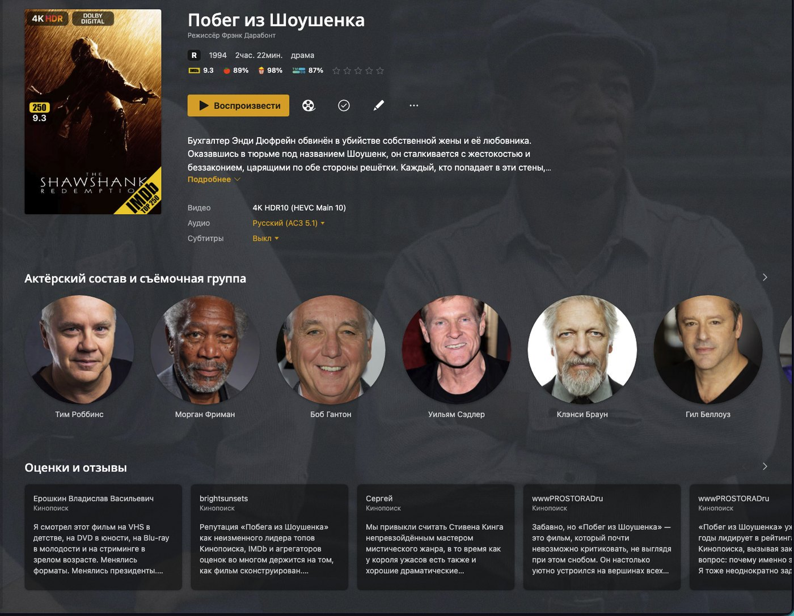
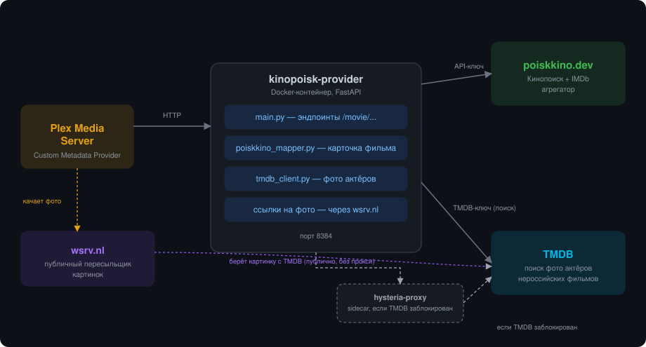

# 🎬 Kinopoisk Custom Metadata Provider для Plex

**Метаданные с Кинопоиска для Plex Media Server** — описание, рейтинги, актёрский состав, рецензии на русском, интересные факты, коллекции по франшизам и фото актёров. Замена `Kinopoisk.bundle`, который Plex не запускает с версии 1.43.0.

Автор: **Sergey Sychev** · [English](README.en.md) · Лицензия MIT



*Так выглядит карточка: описание и рецензии на русском, рейтинги Кинопоиска и IMDb, бюджет и сборы, интересные факты, фото актёров.*

---

## Зачем это нужно

Plex когда-то поддерживал сторонние агенты метаданных (legacy plugins), и для Кинопоиска был `Kinopoisk.bundle`. Начиная с версии PMS **1.43.0** Plex убрал старый движок плагинов совсем — старые агенты просто не запускаются. Взамен появился новый официальный механизм **Custom Metadata Providers**: обычный HTTP-сервис, который Plex дёргает сам при добавлении фильма и обновлении метаданных.

Этот проект — такой сервис для Кинопоиска, упакованный в Docker и готовый к разворачиванию на чём угодно.

## Что вы получите на карточке фильма

- Название, год, слоган, описание — **на русском**
- Рейтинги Кинопоиска и IMDb (текстом в описании — см. [FAQ](#почему-рейтинг-в-виде-текста-а-не-бейджа))
- Полный актёрский состав и съёмочная группа
- **Фото актёров с TMDB** для нероссийских фильмов — нужен только бесплатный ключ TMDB, больше ничего настраивать не надо (с v0.18.2)
- Рецензии **на русском языке** с Кинопоиска
- **Интересные факты и киноляпы** с Кинопоиска, бюджет и сборы
- **Коллекции по киносериям** — «Мстители», «Гарри Поттер», «Хоббит»
  собираются автоматически, все части в одной коллекции
- Похожие фильмы
- Год выхода по **мировой** премьере, а не по дате российского проката
- Номера фильма на IMDb и TMDb в карточке — по ним внешние инструменты
  (например, Kometa) раскладывают фильмы по коллекциям

## Как это устроено



Основные данные всегда идут с Кинопоиска через **[poiskkino.dev](https://poiskkino.dev)** (агрегатор Кинопоиск + TMDb + IMDb). Фото актёров для нероссийских фильмов дополнительно ищутся на TMDB — если TMDB заблокирован в вашей сети (частая ситуация для России), есть встроенная опциональная поддержка прокси для поиска.

Сами картинки Plex забирает **не у провайдера**, а через публичный пересыльщик [wsrv.nl](https://wsrv.nl): тот скачивает файл с `image.tmdb.org` и отдаёт со своего публичного адреса. Так сделано потому, что Plex не скачивает картинки с адресов внутри локальной сети — он обрывает такой запрос ещё до отправки. Побочная польза: ни прокси для картинок, ни публичного адреса у себя дома не нужно.

С v0.17.0 тот же TMDB-ключ играет вторую роль — аварийный фолбэк, когда у poiskkino.dev закончилась суточная квота (см. [FAQ](#новые-фильмы-приходят-в-plex-пустыми-нет-описания-постера-каста)).

---

## Быстрый старт (любая платформа с Docker)

Нужен только **Docker** и **Docker Compose** — не важно, Синологи это, Unraid, QNAP, обычный Linux-сервер, или Docker Desktop на Windows/Mac.

### 1. Получите API-ключ

Зарегистрируйтесь в Telegram-боте **[@poiskkinodev_bot](https://t.me/poiskkinodev_bot)** и получите бесплатный API-ключ poiskkino.dev (бесплатный тариф — 200 запросов/сутки, этого достаточно для домашней библиотеки).

### 2. Скачайте проект

```bash
git clone https://github.com/Serka76/Kinopoisk-Provider.git
cd Kinopoisk-Provider
```

(Или просто скачайте и распакуйте zip-архив с релизом.)

### 3. Настройте ключи

```bash
cp docker-compose.yml.example docker-compose.yml
cp .env.example .env
```

Ключи впишите в `.env` — он лежит в `.gitignore`, так что в репозиторий не уедет:

```ini
POISKKINO_API_KEY=ваш_ключ_из_бота
TMDB_API_KEY=ваш_ключ_tmdb
```

Ключ TMDB бесплатный и необязательный, но с ним в карточке появляются фото актёров, и карточки не пустеют, когда у Кинопоиска кончается суточная квота. Подробности — в [разделе про TMDB](#фото-актёров-с-tmdb-опционально) ниже.

### 4. Запустите

```bash
docker compose up -d --build
```

Проверьте, что сервис поднялся:

```bash
curl http://localhost:8384/healthz
# {"status":"ok","version":"0.18.3","build":"2026-11-05","author":"Sergey Sychev"}
```

### 5. Подключите провайдер в Plex

1. Откройте Plex Web → **Settings → Metadata Agents**
2. **Add Provider** → укажите ссылку: `http://<IP-вашего-сервера>:8384/movie`
   *(если Plex тоже в Docker на той же машине — используйте настоящий IP машины, не `localhost`)*
3. **Add Agent** → задайте имя (например «Кинопоиск RU»)
4. Добавьте в агент **оба** провайдера: свой Kinopoisk-провайдер **первым** (Primary), и **Plex Movie** вторым (запасной источник для полей, которые Кинопоиск не покрывает)
5. Откройте нужную библиотеку → **Edit → Advanced → Agent** → выберите «Кинопоиск RU» → Save
6. Запустите **Refresh All Metadata** на библиотеке

Готово — новые и существующие фильмы начнут получать метаданные с Кинопоиска.

---

## Установка на конкретных платформах

<details>
<summary><b>🖥️ Synology (Container Manager)</b></summary>

1. Через **File Station** загрузите папку проекта на NAS, например в `/docker/kinopoisk-provider`
2. Откройте **Container Manager → Проект → Создать**
3. Название проекта: `kinopoisk-provider`, Путь: укажите загруженную папку
4. Источник: «Загрузить docker-compose.yml» — Container Manager сам найдёт файл в папке
5. На экране веб-портала ничего не включайте — не нужно
6. **Собрать** → **Пуск**
7. Проверьте `http://<IP-Synology>:8384/healthz` в браузере

При любом обновлении файлов: **Остановить → удалить старый образ в разделе «Образ» → Собрать → Пуск** — Synology иногда слишком агрессивно кэширует сборку, и без удаления образа изменения не подхватываются.

</details>

<details>
<summary><b>🐧 Unraid</b></summary>

1. Установите плагин **Compose Manager** из Community Applications (если ещё не установлен)
2. Скопируйте папку проекта в `/mnt/user/appdata/kinopoisk-provider`
3. В Compose Manager добавьте новый стек, указав путь к папке
4. Впишите ключи в `docker-compose.yml` так же, как описано в Быстром старте
5. Запустите стек

</details>

<details>
<summary><b>📦 QNAP (Container Station)</b></summary>

1. Загрузите папку проекта через File Station
2. **Container Station → Приложения → Создать** → выберите «Создать приложение через docker-compose.yml», укажите путь к файлу
3. Запустите приложение

</details>

<details>
<summary><b>🐳 Обычный Linux-сервер / Docker Desktop (Windows, Mac)</b></summary>

Просто выполните шаги из «Быстрого старта» выше через терминал — `git clone` → `docker compose up -d --build`. Никаких платформенных особенностей нет.

</details>

---

## Фото актёров с TMDB (опционально)

Для нероссийских фильмов провайдер ищет фото актёров на TMDB — они подобранные и свежие, тогда как у Кинопоиска часто стоит случайный кадр двадцатилетней давности. Без ключа всё продолжит работать, просто фото возьмутся с Кинопоиска для всех фильмов.

### Обычный случай

1. Получите бесплатный API-ключ на [themoviedb.org/settings/api](https://www.themoviedb.org/settings/api) (обычный **API Key**, не Read Access Token)
2. Впишите его в `docker-compose.yml`:
   ```yaml
   - TMDB_API_KEY=ваш_ключ_tmdb
   ```
3. Перезапустите контейнер — готово

Больше ничего не нужно: ни публичного адреса, ни обратного прокси. Картинки Plex берёт через публичный пересыльщик (см. «Как это устроено»).

Этот же ключ автоматически работает как аварийный источник, когда у poiskkino.dev заканчивается суточная квота, — см. [FAQ](#новые-фильмы-приходят-в-plex-пустыми-нет-описания-постера-каста).

### Если TMDB заблокирован (частая ситуация для российских сетей)

Заблокирован бывает **сам API** TMDB — то есть поиск, по которому провайдер узнаёт, где лежит фото. Сами картинки идут через пересыльщик и в прокси не нуждаются.

Понадобится свой VPN/прокси-сервер с протоколом **Hysteria2**. Проект включает готовый sidecar-контейнер, который сам разбирает ссылку подключения — вручную ничего парсить не нужно.

1. В `docker-compose.yml` найдите сервис `hysteria-proxy` и впишите свою ссылку целиком:
   ```yaml
   - HYSTERIA2_URL=hysteria2://AUTH@HOST:PORT/?insecure=1&sni=example.com#name
   ```
2. Убедитесь, что провайдеру задан `TMDB_PROXY_URL=socks5://hysteria-proxy:1080`
3. Перезапустите оба контейнера

### Если пересыльщик вам не подходит

Пересыльщик — сторонний бесплатный сервис. Если не хотите зависеть от него, выключите его (`TMDB_IMAGE_MIRROR=`) и задайте `PUBLIC_BASE_URL` — **публичный** адрес, по которому ваш провайдер доступен из интернета. Тогда картинки пойдут через собственный `/image-proxy`. Локальный адрес здесь не подойдёт: Plex за картинками в локальную сеть не ходит, и в этом случае фото останутся кинопоисковскими.

---

## Обновление

```bash
cd Kinopoisk-Provider
git pull
docker compose up -d --build
curl http://localhost:8384/healthz   # версия должна смениться
```

Если версия в ответе не поменялась — Docker взял сборку из кэша: остановите контейнер, удалите его образ (`docker rmi`, в Synology — раздел «Образ») и соберите заново.

Что изменилось в каждой версии — в [CHANGELOG.md](CHANGELOG.md), там же списки правок по датам.

---

## Переменные окружения — справочник

| Переменная | Обязательна | Описание |
|---|---|---|
| `POISKKINO_API_KEY` | ✅ Да | Ключ poiskkino.dev из `@poiskkinodev_bot` |
| `TMDB_API_KEY` | Рекомендуется | Ключ TMDB — для фото актёров нероссийских фильмов, а с v0.17.0 ещё и для фолбэка, когда суточная квота poiskkino.dev исчерпана (см. FAQ ниже) |
| `HYSTERIA2_URL` | Нет | Ссылка на ваш Hysteria2-прокси, если TMDB заблокирован |
| `TMDB_PROXY_URL` | Нет | Обычно `socks5://hysteria-proxy:1080`, если используете встроенный sidecar |
| `PUBLIC_BASE_URL` | Нет | Нужна, только если вы отключили пересыльщик (`TMDB_IMAGE_MIRROR=`) и раздаёте фото сами. Это должен быть **публичный** адрес провайдера: на локальный Plex за картинками не ходит |
| `IMAGE_PROXY_HOSTS` | Нет | С v0.18.0 — список хостов (через запятую), картинки с которых разрешено скачивать через `/image-proxy`. По умолчанию `image.tmdb.org`; менять нужно только если подставляете в провайдер другой источник картинок |
| `TMDB_PERSON_PHOTOS` | Нет | С v0.18.1 — брать ли фото актёров с TMDB. По умолчанию решается само: если `PUBLIC_BASE_URL` указывает на адрес локальной сети, фото берутся с Кинопоиска (Plex не скачивает картинки с приватных адресов). `1` — всегда TMDB, `0` — всегда Кинопоиск |
| `TMDB_IMAGE_MIRROR` | Нет | С v0.18.2 — публичный пересыльщик картинок для фото с TMDB, по умолчанию `https://wsrv.nl/?url=`. Нужен потому, что Plex не скачивает картинки с приватных адресов. Пустое значение выключает его (тогда понадобится публичный `PUBLIC_BASE_URL`) |
| `FACTS_LIMIT` | Нет | Сколько интересных фактов и киноляпов показывать в описании. По умолчанию 10 (до v0.18.3 было жёстко 5) |

---

## FAQ / Troubleshooting

#### Провайдер не появляется в Plex / ошибка "unsupported metadata types"
Проверьте версию PMS — нужна **1.43.0 или новее**. Также убедитесь, что ссылка в Plex указывает на `/movie` в конце (`http://IP:8384/movie`), а не просто на корень.

#### После обновления файлов ничего не изменилось
Docker закэшировал старую сборку. Остановите контейнер, удалите его образ (в Synology — раздел «Образ»; в обычном Docker — `docker rmi`), затем соберите заново.

#### Рецензии не появляются, хотя всё остальное работает
Убедитесь, что в объекте рецензии заполнено поле `tag` — без него Plex, похоже, бракует весь массив рецензий целиком и незаметно откатывается на резервный источник (Plex Movie/Rotten Tomatoes).

#### Почему рейтинг в виде текста, а не бейджа?
На момент написания (версия PMS 1.43.x) отображение рейтинга от custom-провайдеров, похоже, не реализовано на стороне Plex — несколько разных вариантов схемы (`Rating[]`, плоские поля `rating`/`audienceRating`) не приводят к появлению цветного бейджа. Рейтинг с Кинопоиска и IMDb поэтому дублируется текстом в описании. Если Plex это когда-нибудь исправит — попробуйте убрать этот текстовый блок из `poiskkino_mapper.py`.

#### Новые фильмы приходят в Plex пустыми (нет описания, постера, каста)
С v0.17.0 это почти всегда суточная квота poiskkino.dev (free-тариф —
200 запросов/сутки), а не поломка. Проверьте `docker compose logs -f
kinopoisk-provider` — если видите `провайдер недоступен (Превышен
суточный лимит запросов...)`, значит квота действительно кончилась,
обычно после массового добавления фильмов разом (например, после
докачки большой коллекции через Radarr — на первичный мэтч одного нового
фильма уходит не один запрос). Если задан `TMDB_API_KEY`, провайдер
автоматически подставит урезанные данные с TMDB (без отзывов и рейтинга
Кинопоиска, но не пустые) и сам обновит карточку до полной версии с
Кинопоиска на следующий Refresh Metadata, когда квота освободится —
никаких действий руками не требуется, кроме как подождать. Если
`TMDB_API_KEY` не задан — фолбэк недоступен, карточки останутся пустыми
до сброса квоты, как и в версиях до 0.17.0.

#### 500 Internal Server Error / "Неверный или отсутствующий X-API-KEY"
Проверьте `docker-compose.yml` на лишние пробелы вокруг значения ключа (частая проблема при копипасте, особенно с Windows) — сам провайдер уже обрезает пробелы автоматически (`.strip()`), но стоит перепроверить, что скопирован именно текущий, не отозванный ключ.

#### TMDB-фото не находятся вообще (`tmdb_photos_found=0`)
Проверьте лог контейнера — там печатается точная причина (неверный ключ, таймаут, блокировка). Если видите `Cannot assign requested address` или `All connection attempts failed` — TMDB заблокирован в вашей сети, нужен прокси (см. раздел выше).

#### TMDB-фото находятся, но не отображаются на карточке
Так было до v0.18.2. Причина: Plex **не скачивает картинки с адресов внутри локальной сети** — он обрывает запрос ещё до отправки, а в журнале PMS появляется `operation aborted by pre-request callback` по строке на каждого актёра. Поэтому ссылки вида `http://192.168.x.x:8384/image-proxy?...` не работали никогда, какой бы `PUBLIC_BASE_URL` ни был задан.

С v0.18.2 картинки идут через публичный пересыльщик, и это лечится само — просто обновитесь. Если фото всё ещё нет: проверьте, что задан `TMDB_API_KEY`, что `TMDB_IMAGE_MIRROR` не пустой, и запустите Refresh Metadata на фильме (у уже созданных карточек фото не меняются сами).

#### Актёры совсем без фото (пустой кружок с инициалами)
Значит фото не нашлось ни на Кинопоиске, ни на TMDB (обычно для эпизодических ролей) — это нормально, не баг.

#### В библиотеке сотни коллекций с именами вроде `year2010-2019` или `genredrama`
Это наследие версий до 0.16.0: тогда коллекции строились из поля `lists`, а там лежат подборки самого сайта Кинопоиска — жанры, десятилетия, страны, кассовые сборы. Обновитесь до 0.16.0 или новее, и провайдер перестанет их присылать. Уже созданные коллекции останутся в базе Plex — удалите их вручную через **Библиотека → Коллекции** или скриптом через API (`GET /library/sections/{id}/collections`, затем `DELETE /library/collections/{id}`).

#### Части франшизы не собираются в одну коллекцию
Коллекция строится по общему префиксу названий всех частей серии. Если названия расходятся уже внутри слова — например, «Чужой» и «Чужие» дают общий префикс «Чуж» — провайдер намеренно не создаёт коллекцию, чтобы не плодить обрубки. Такие серии проще собрать вручную в Plex.

---

## Что дальше не реализовано (известные ограничения)

- Трейлеры — эндпоинт `/extras` реализован, но схема ответа для custom-провайдеров нигде не описана, и подтверждения, что Plex её принимает, пока нет
- Данные для сериалов — реализовано только для фильмов
- Старые номера фильма, которые Plex записал в карточку раньше, он не стирает сам: при перепривязке к другому фильму прежние `tmdb://`/`imdb://` остаются в карточке рядом с новыми. Это ограничение Plex, обойти со стороны провайдера нельзя

## Лицензия и вклад в проект

Лицензия **MIT** — см. [LICENSE](LICENSE). Свободно используйте, форкайте и дорабатывайте. Если найдёте баг или улучшение — присылайте issue/pull request.

---

*Полная история изменений — [CHANGELOG.md](CHANGELOG.md)*
